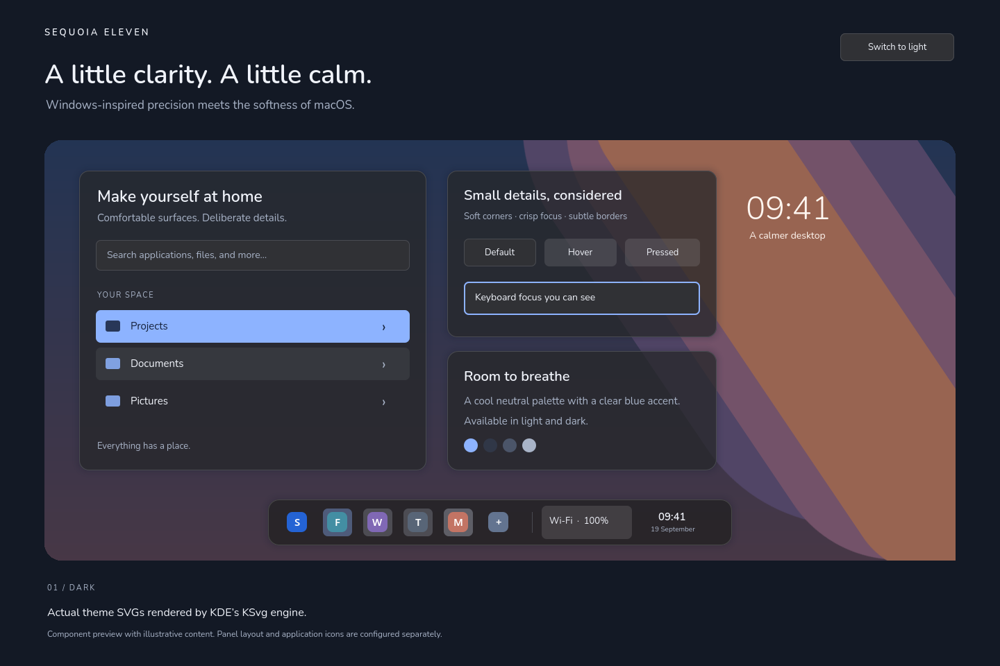
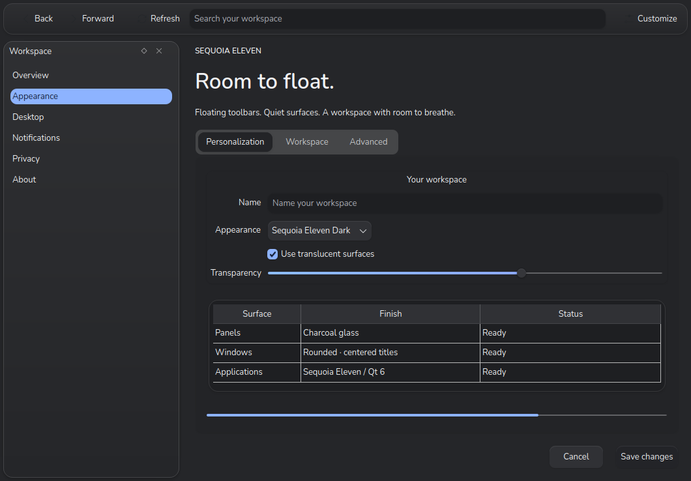
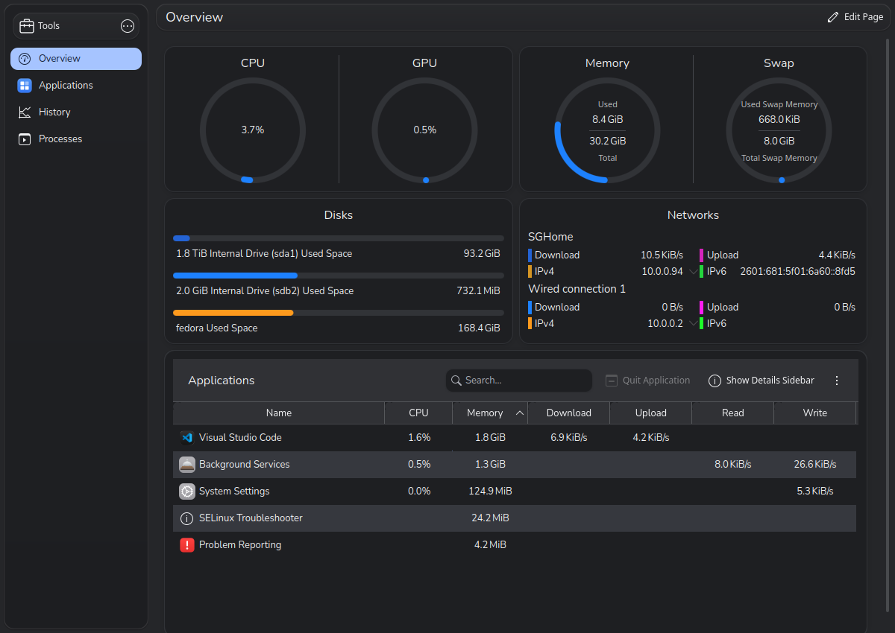
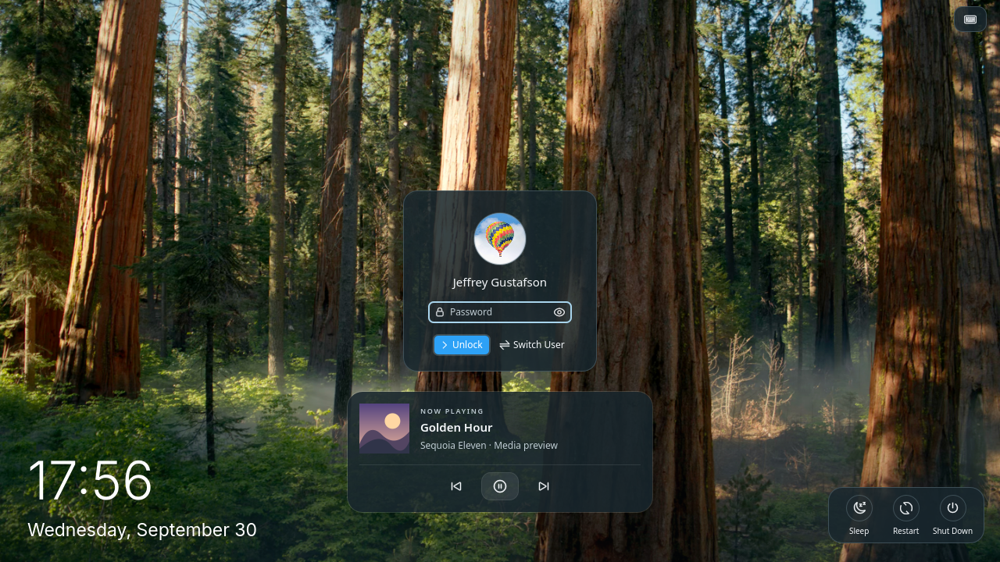
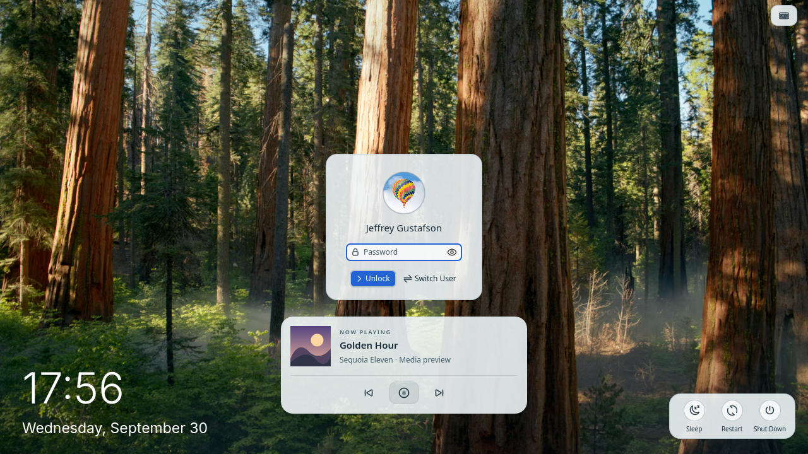
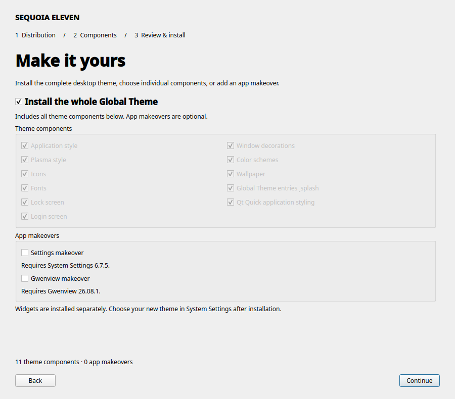
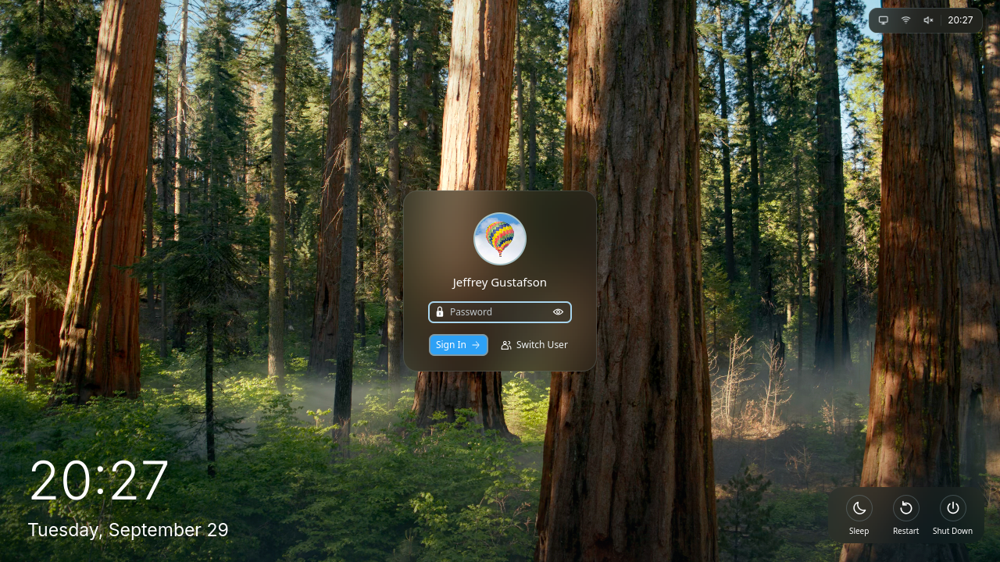
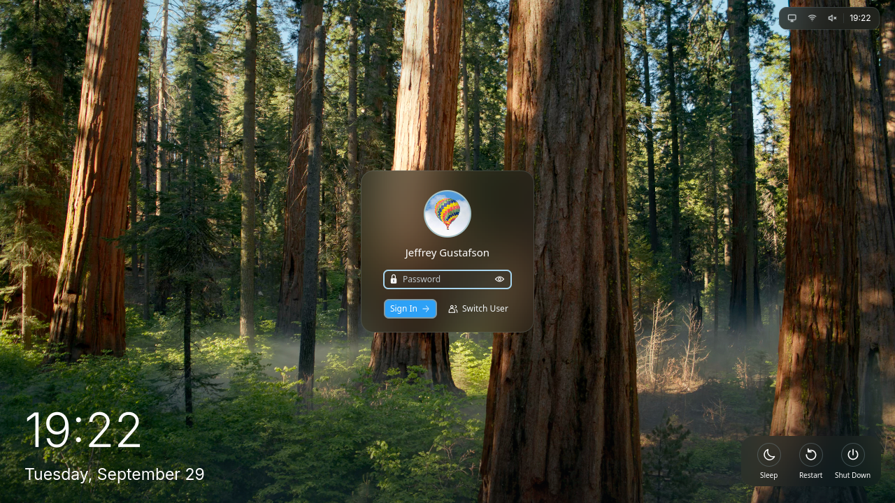

# Sequoia Eleven

A coordinated Plasma desktop inspired by macOS Sequoia and Windows 11: neutral
materials, soft corners, compact controls, and clear blue application selections.
Available in Light and Dark, with a matching wallpaper that follows the system
color scheme. Includes Sequoia Tahoe icons with bold, smooth action glyphs;
your panel layout is preserved unless you choose the bundled desktop layout.

Both appearances now include **Solid** and **Transparent** application finishes,
with matching native window decorations. Choose **Sequoia Eleven Light Solid**,
**Light Transparent**, **Dark Solid**, or **Dark Transparent** in System Settings
→ Colors & Themes → Global Theme to select a coordinated set. The color schemes
also appear under Colors; **Sequoia Eleven Solid** and **Sequoia Eleven Transparent**
appear under Window Decorations and follow the selected light/dark palette.

Every color scheme sets **Frames and Outlines** to **0%**. View backgrounds match
the window's RGB colors, with independent opacity. Transparent uses a frosted
application canvas and titlebar (72% tint), with **solid floating toolbars,
sidebars, content views, and cards**. Rounded corners, inset spacing, and soft
shadows separate these islands from the glass around them. Text, icons,
selections, and button faces keep their normal opacity. The compiled Qt style
enables compositor blur; the Quick extension supplies matching opaque islands
over transparent pages in supported KDE apps. The glass canvas uses the same
tint as the native titlebar for a continuous finish. Solid uses opaque application
surfaces and titlebars.
Plasma panels and desktop widgets retain their existing finishes.








## What is included

- **Sequoia Tahoe icons:** bundled MacTahoe application and folder artwork with
  heavier monochrome action, toolbar, and tray glyphs. Light and dark variants
  follow the selected global theme. Original Tahoe installations remain available.
- **Plasma style:** charcoal or porcelain panels, translucent widget and OSD
  backgrounds, corrected rounded shadows, compact task highlights, and subtle
  gray/white active panel-widget highlights. Desktop widgets with standard
  backgrounds use Plasma's wallpaper blur, clipped to their rounded corners.
  Panel blur masks sit one pixel inside the rounded border to contain edge spill.
  The application style leaves Plasma's blur regions intact so floating panels
  retain those rounded masks when shown or recreated.
  Frosted light widgets use a white tint and fine bright rim; dark widgets use
  charcoal glass with a softer rim, preserving diffuse wallpaper color beneath.
  Add Widgets opens a centered, rounded gallery with adaptive card columns.
  It fits the current monitor's available area in logical pixels (including display
  scaling), uses up to 86% of its width and 82% of its height, and is capped at
  1080×760 logical pixels including the Plasma frame. Small screens get compact
  controls and a scrolling grid. The native installed-widget catalog, search,
  categories, keyboard controls, and click/drag adding remain available.
  Existing managed installations can update only the picker with
  `python3 tools/install-widget-picker.py`, then reload Plasma Shell. This keeps
  local edits to other shell components intact and backs up the previous picker.
- **Color schemes:** coordinated window, view, toolbar, selection, disabled,
  inactive, and complementary colors for both appearances.
- **Application style:** a separate, compiled Qt 6 fork of Darkly, with all source
  bundled in this project. Tahoe-inspired floating toolbar and sidebar islands, inset
  content views, 14px surface corners, and soft shadows in both
  appearances. Rounded controls, slim scrollbars, segmented tabs, translucent
  menus, and restrained animation complete the style.
  Native KDE settings sidebars reserve enough width for their labels and inset
  selection highlights, including Konsole's profile settings.
  Konsole's session tabs omit the contrasting background strip, retain a rounded
  active tab, and use rounded, matching backgrounds for overflow arrows.
- **Qt Quick/Kirigami extension:** matching floating drawers, page headers,
  framed scroll views, and rounded cards for System Monitor, System Settings,
  and Discover, activated through reversible user-local application launchers.
- **Window decoration:** a separate native KWin plugin with rounded corners,
  centered titles, compact title bars, and red/yellow/green controls. Inactive
  controls become neutral; hovering reveals their symbols without enlarging them.
- **Typography:** bundled Adwaita Sans (Inter-based) for clear desktop, menu,
  toolbar, and window-title text. Regular 10pt UI text, medium 10pt titles, and
  conservative smoothing; Nunito remains available for the clock and splash.
- **Lock screen:** a large, quiet clock, prominent avatar, compact translucent password
  field with a smooth white border, compact unlock button without hover scaling, steady action buttons, a gently shaded wallpaper,
  and a compact album-art media card with accessible playback controls that follows
  the active light/dark color scheme.
- **Global Themes:** Light and Dark entries in System Settings and a matching
  startup splash. The lock-screen layout is shared by both appearances and follows the desktop light or dark palette.
- **Login screen:** a system-wide Plasma Login Manager installer shares the
  Sequoia Eleven colors, Plasma controls, Adwaita Sans font, and adaptive wallpaper.
  A settings watcher follows the selected desktop account's light/dark variant.
- **Adaptive wallpaper:** the preview's blue gradient and rounded lavender,
  rose, and peach bands in coordinated light and dark palettes. One native KDE
  wallpaper package includes both 3840×2160 images and editable SVG sources.

## Install with the graphical interface

Open **Install Sequoia Eleven.desktop** in this folder (allow the launcher to
run if your file manager asks), or run:

```sh
./install-gui.py
```

The native Qt wizard guides you through:

1. **Distribution:** Arch Linux, Fedora, Ubuntu, or Debian. The installed distro
   is detected and checked before invoking its package manager.
2. **Components:** choose the complete desktop or individual components.
   The complete-desktop option checks and grays out the component choices; turning it
   off restores your individual choices. **Settings**, **Gwenview** and **KCalc** makeovers
   are separate, optional choices, including when installing no theme components.
   **Desktop widgets** can be installed on their own. Selecting **Global Theme,
   desktop layout & splash** automatically includes its required application style,
   decorations, Plasma style, colors, icons, wallpaper, fonts and widgets. Those
   requirements are shown in the selection and review; turn off Global Theme to
   choose those parts individually. Login, lock screen and Qt Quick styling remain
   separate choices.
3. **Review and install:** inspect the selection and dependency list, then follow
   progress in the window. Administrator passwords are requested through a
   separate dialog; the installer itself runs as your desktop user. Logs can be saved.



If PySide6 QtWidgets is missing, the launcher offers to install the distribution
package using KDE's dialog and authentication tools (`kdialog` and `pkexec`).
On desktops without these tools, install `pyside6` on Arch,
`python3-pyside6` on Fedora, or `python3-pyside6.qtwidgets` on Ubuntu/Debian first.
Keep the launcher in the project folder so it can find the sources and tools.

The installer uses `pacman`, `dnf`, or `apt-get` and installs only missing
dependencies needed by the selection. Package names are based on the official
[Arch](https://archlinux.org/packages/),
[Fedora](https://packages.fedoraproject.org/),
[Debian](https://packages.debian.org/), and
[Ubuntu](https://packages.ubuntu.com/) catalogs. Your enabled repositories must
provide those packages; the installer does not change repositories or upgrade
your distribution. Only Fedora has had an actual installation test in this workspace.

Native theme, Settings, Gwenview and KCalc builds automatically use all available logical
CPU cores and report the parallel job count in the installation log. An explicit
`BUILD_JOBS=2` environment setting can limit builds when needed.
Gwenview dependencies include both the Qt 6 annotation and color-picker development
packages. If an older installer stopped with a missing `kColorPicker-Qt6` error,
extract the updated installer and select only **Gwenview makeover** to retry.

Use KDE Plasma 6 with Qt 6.7 or newer and KDE Frameworks 6.10 or newer for the
native theme; window decorations require KDecoration3. The bundled app forks
require **System Settings 6.7.5** (Qt 6.10+, Frameworks 6.26+),
**Gwenview 26.08.1**, and **KCalc 26.08.1** respectively. Version checks run before package installation.
Quick styling and lock-screen overrides also validate the installed KDE sources;
different releases may need updated overrides. Choosing a distro does not make
older KDE releases compatible. The login screen is omitted from the GUI's full
theme selection and default CLI installation when Plasma Login Manager is unavailable;
SDDM is not replaced. An explicit `--components login` request requires that manager.

Installing a component later preserves other installed components and their
uninstall receipts. If a later step fails, completed steps and installed
dependencies remain; the log identifies completed steps. Choose the installed
theme in System Settings and reopen apps after installation. The Settings makeover
also adds **System Settings (Sequoia Eleven)** to the application menu, so it
works without editing your PATH. The Desktop widgets component includes the custom
System Tray, Trash, animated task manager and six layout widgets, and is also
included by Global Theme. Native widgets are built on the destination computer.
Open `./uninstall-gui.py` to remove selected theme components or app makeovers.
The app-specific command-line helpers remain available:

```sh
python3 tools/install-settings-navigation.py --remove
python3 tools/install-gwenview.py --remove
python3 tools/install-kcalc.py --remove
```

## Command-line installation

Tested on Fedora 44, Plasma 6.7.5, Qt 6.11.2, and KDE Frameworks 6.30.

Run as the desktop user, without starting the script with sudo:

```sh
./install.sh
```

The installer detects the distribution and installs missing build dependencies,
builds the Qt 6 application style and KWin decorations, and stages all files before
installation. It installs Plasma styles, all Global Theme/color variants, icons,
splash, the lock-screen override, Quick application styling, bundled fonts, and
adaptive wallpaper and, when supported, the custom Plasma Login screen. Native plugins and login
assets are shared system files; the remaining theme
files and application launchers are installed for the current account.

The Desktop widgets component installs missing Start Menu, Downloads Stack, Dock
Separator, Kpple Menu and Window Title Fork packages. Separately installed copies
are preserved through installation, refresh and removal. It also builds the
native tray, trash and animated task-manager forks, with their runtime dependencies.
Global Theme includes this component automatically. The separate
[widget archive installer](plasma/WIDGETS.md) remains available.
`install.sh` does not change panels, restart Plasma, activate a
theme, or change authentication settings. The login theme loads after reboot;
Plasma Login Manager must already be installed. SDDM is not supported.

Choose a Sequoia Eleven Global Theme in System Settings after installation.
Enable **Desktop layout** (called **Use desktop layout from theme** in some
Plasma versions) when applying it to recreate the saved top bar and dock.
Leave that option unchecked to keep your current panels and widgets.
See [the bundled layout details](plasma/layouts/README.md).
Alternatively, activate it explicitly, with a settings snapshot:

```sh
python3 tools/apply-desktop.py --mode dark --material solid
```

`apply-desktop.py` only selects already-installed components; it does not install
packages, rebuild plugins, or copy theme assets. Re-run `./install.sh` to update.
Use `./install.sh --plan` to inspect the scope and dependency list without changes.
`--skip-deps` skips package installation when dependencies are already available.
Use `--distro arch`, `--distro fedora`, `--distro ubuntu`, or `--distro debian`
to select the package profile explicitly. Installation checks that it matches
the host. Native plugin locations follow Fedora, Arch, or Debian/Ubuntu's
multiarch layout. To install just selected components, for example:

```sh
./install.sh --components icons colors wallpaper
./install.sh --components widgets
./install.sh --components global-theme
./install.sh --distro debian --components colors --plan
```

Run `./install.sh --help` for component identifiers. Omitting `--components`
installs the complete desktop, omitting the login screen if Plasma Login Manager
is unavailable. `--components global-theme` includes everything referenced by its
presets; `--components widgets` installs widgets without changing your theme.

Paths are derived from the checkout and the current account. Copied CMake builds
are detected and rebuilt by `tools/build-desktop.sh`. You can omit `build/` and
`.staging/` when copying the project; each account runs its own installation.
`--prefix /path/to/data` changes the user data destination, while native plugins
still install system-wide. For isolated staging without sudo or host package
changes, supply both destinations:

```sh
./install.sh --skip-deps --prefix /tmp/sequoia-user --system-root /tmp/sequoia-system
./uninstall-gui.py --prefix /tmp/sequoia-user --system-root /tmp/sequoia-system
```

### Uninstall

Open **Uninstall Sequoia Eleven.desktop**, or run as the same desktop user:

```sh
./uninstall-gui.py
```

The graphical uninstaller lets you select the whole theme, individual components,
and the Settings/Gwenview/KCalc makeovers. Review the selection before clicking
**Remove selected components**, then follow progress and save the log if needed.
Use **Open Appearance Settings** to select another theme first, and replace any
Sequoia panel widgets you intend to remove. Removing a component also removes
Global Theme presets that depend on it; other installed components are preserved.
No distribution selection or build tools are required for removal. The launcher
can install PySide6 using the same desktop prompt as the installer if necessary.

Receipts under `$XDG_DATA_HOME/sequoia-eleven/theme-installation` (normally
`~/.local/share/sequoia-eleven/theme-installation`) and
`/var/lib/sequoia-eleven/theme-installation` track the exact files installed.
Uninstall removes those theme files, restores original application launchers,
and removes empty directories it created. Reinstallation preserves the original
launcher backups. Known theme paths from older manual installations are adopted
when installing; they are removed instead of restoring an obsolete theme version.
Other files, personal settings/snapshots, separately installed widgets/login files,
and shared distribution packages are retained. Locally edited managed files stop
removal before it begins; save those changes before enabling **Also remove locally
edited files**. Every selected theme/app receipt is checked before removal starts.

Native plugins and the login theme are shared across accounts. Select **Keep shared
system files for other accounts** to remove only the current account's files.
Uninstall needs the same `--prefix`/`--system-root` or XDG settings used at install.
An installation must have a receipt; the uninstaller does not guess what to delete
from an account that has never run this installer.

For terminal automation, use the same removal backend:

```sh
python3 tools/uninstaller_run.py --components colors
python3 tools/uninstaller_run.py --apps settings gwenview
python3 tools/install-theme.py uninstall --keep-system
```

The GUI also accepts `--prefix`, `--system-root`, and `--bin-prefix` for custom
destinations. The old top-level shell uninstaller has been replaced by the GUI.

Per-user installers honor `XDG_DATA_HOME` and `XDG_CONFIG_HOME`; unset or empty
values use the normal directories under the current home. Snapshots can also be
restored when these directories are outside the home folder. Keep the same XDG
settings when restoring. Account-path test coverage and its limits are recorded
in [VALIDATION.md](VALIDATION.md).

Use `--mode light` for the light appearance. The application and decoration plugin
names are `SequoiaEleven` and `org.kde.sequoiaeleven`; the original Darkly source,
plugins, and settings are untouched. The fork's settings live in `sequoiaelevenrc`.
Restart open applications to load the new application style. The lock-screen
changes appear the next time the screen locks; the splash appears at login.
Use `--material transparent` for the frosted variant, or `--material legacy` for
the original customizable appearance. The build installs both new decoration
plugins alongside the original `org.kde.sequoiaeleven` plugin. To add the new
choices to an existing installation without selecting a theme, run `./install.sh`.
The optional apply script selects the adaptive wallpaper on the desktops. Pass
`--keep-wallpaper` to that script to retain your current background.

The full installer installs Adwaita Sans for UI text and Nunito for the clock
and splash. Both theme variants use the same UI font sizes; fixed-width
terminal/editor fonts are preserved. Both families are bundled unmodified with
SIL Open Font Licenses and SHA-256 manifests, so installation needs no download.
To install just the font files, run `python3 tools/install-fonts.py`.

To apply the UI fonts and smoother rendering to an existing desktop, run
`python3 tools/apply-fonts.py`. It snapshots the affected files, selects Adwaita
Sans for KDE and GTK UI text, and sets grayscale antialiasing with slight hinting.
It preserves font size, DPI, panel geometry, and menu spacing. The script prints
a restore command; reopen applications to refresh their text rendering. Compare
actual Qt-rendered text in [the font preview](preview/fonts.png).

The apply script saves a timestamped snapshot under
`~/.local/share/sequoia-eleven/backups/` before changing settings. It prints the exact restore command:

```sh
python3 tools/restore-desktop.py /path/to/the/backup
```

Restore returns the saved settings (and local artwork for older snapshots). The independently named
compiled plugins remain installed but unused. Log out and back in after restoring.

## Artwork-only installation

For development-only artwork staging, `tools/install-theme-assets.sh --prefix
/path/to/data` copies Plasma styles, Global Theme/color variants, Sequoia Tahoe
icons, and wallpaper. This internal helper does not install native plugins or
create uninstall receipts; use `./install.sh` for a normal installation.
Select **Sequoia Eleven** in Wallpaper settings, with dynamic switching set to
follow the color scheme. Select the wallpaper package rather than an individual
PNG so Plasma can choose its light or dark image automatically. Both Global
Themes also name this package as their default wallpaper.
The archives in `dist/sequoia-eleven-{light,dark}-2.0.0.tar.gz` contain these styles.
The standalone wallpaper is in `dist/sequoia-eleven-wallpaper-2.0.0.tar.gz`.
The standalone icon family is in `dist/sequoia-tahoe-icons-2.0.0.tar.gz`;
install all three SequoiaTahoe directories together under `~/.local/share/icons`.
The desktop source archive contains the complete source and installation tools.

| Light wallpaper | Dark wallpaper |
| --- | --- |
|  |  |

## Accent-aware switches

Plasma and the styled Qt Quick applications use compact macOS/iOS-style switches:
a rounded track, inset white thumb, neutral off state, and the account accent when
on. Native click, drag, keyboard, accessibility, and right-to-left behavior remain.
Plasma's SVG uses KDE's [accent-color roles](https://develop.kde.org/docs/plasma/theme/theme-colors/).
The Plasma styles use the account palette instead of shipping a fixed `colors`
override, allowing custom accents to reach the switch artwork and fallback controls.
The separate named Sequoia application color schemes are still included.
Binary on/off actions in Qt Quick menus and native KDE menus use the same toggle
shape and accent. Exclusive menu choices retain radio indicators. Existing switches
in network, Bluetooth, audio, and battery popups inherit the Plasma switch artwork.

Everything is maintained here: `application-style/quick/SwitchIndicator.qml`,
`tools/toggle_assets.py`, and both `plasma/desktoptheme/sequoia-eleven-*/widgets/switch.svg`
files. The normal `./install.sh` includes these changes. For an existing tracked
installation, refresh just the switches with:

```sh
python3 tools/toggle_assets.py
python3 tools/install-switches.py
# Refresh the native KDE menu painter as well:
bash tools/build-desktop.sh
sudo python3 tools/install-switches.py --native
```

The refresh preserves the main installer's ownership receipt and original backups.
Reopen styled applications; log out and back in to reload Plasma's cached SVGs.
The existing Quick application wrapper covers System Settings, Info Center,
System Monitor, Discover, and Merkuro; custom app-defined controls are unaffected.

```sh
python3 tools/verify-switches.py
python3 tools/verify-menu-toggles.py
SEQUOIA_FULL_INSTALL_TEST=1 python3 tools/verify-theme-installer.py
```

This tests input, drag, disabled states, focus, RTL, and runtime accent changes,
and checks rendered Plasma pixels against blue and purple accents in isolated
light/dark settings. Previews: [light](preview/switches-light.png),
[dark](preview/switches-dark.png).

## Floating Qt Quick applications

Qt Quick apps use a separate component layer from the compiled Qt Widgets style.
`./install.sh` includes this extension. After KDE updates, refresh just this
component while preserving the theme installer's ownership records with:

```sh
python3 tools/install-theme.py install --components quick-style --skip-deps
```

The launcher falls back to standard styling when installed KDE components no
longer match the overlay. Fully quit and reopen affected apps after refreshing.
For a standalone development installation without the theme installer, use:

```sh
python3 tools/install-quick-islands.py
```

This requires the system's PySide6 package (`python3-pyside6` on Fedora). It copies
the installed KDE QML components, applies the surface changes, and uses the system
plugin libraries. It creates user-local launchers for installed copies of System
Monitor, System Settings, Info Center, and Discover. Fully quit and reopen those apps from the
application menu. No C++ style rebuild or logout is needed for this extension.
Use `--apps systemmonitor` to select only that app on a first installation.

The extension lives under `~/.local/share/sequoia-eleven/quick-islands/`. With the
Sequoia Eleven application style selected, System Settings, Info Center, System
Monitor, Discover, `kcmshell6`, and Merkuro automatically load the verified shared
Quick surfaces at startup. This also covers executable launches from Control
Center, Sequoia Desktop Menu, Kpple Menu, and terminal commands. The native style
checks the overlay's source hashes before enabling it; Plasma and greeters are
excluded. Installing this behavior requires rebuilding the native application
style as well as installing the Quick component.

System QML files and the Plasma shell stay unchanged. Other compatible native Qt Quick
apps can be launched explicitly through its wrapper:

```sh
~/.local/share/sequoia-eleven/quick-islands/sequoia-quick APPLICATION
```

Application-defined backgrounds and layout overrides may still need individual
adjustments; GTK, Electron, and isolated Flatpak apps are outside this extension.
Merkuro's additional calendar-specific layout overrides still use its desktop
launcher or the explicit wrapper; direct commands get the shared Quick surfaces.
Transparent schemes provide real canvas alpha and request compositor blur,
while drawers, headers, framed views, and cards remain opaque. Solid schemes
keep the same geometry with opaque canvases too. Restart applications
after changing material so their window buffers and palettes are recreated.
Application-specific overrides live under `apps/`, with one folder per app.
The [KCalc makeover](apps/kcalc/README.md) adds rounded keys, calculation history
above the input, live inline answers, a visible mode selector, and automatic
sizing when switching calculator modes.
Manual resizing stays available; maximized and fullscreen windows retain their size.
Select **KCalc makeover** in the installer, or build and install it with
`python3 tools/build-kcalc.py` and `python3 tools/install-kcalc.py --skip-build`.
The [Falkon browser makeover](apps/falkon/SEQUOIA.md) adds rounded tabs, a unified
address bar, searchable open tabs, a Library menu, and a refreshed light/dark
start page to the native Qt 6 browser, plus stock ad/tracker protection using
uBlock Origin's network engine and Falkon's CSS filtering. The active Git
checkout is `apps/falkon`; the earlier custom source remains in `apps/falkon1`.
Build with `python3 tools/build-falkon.py` and run with
`python3 apps/falkon/launch.py` using its dedicated browser profile.
The [Gwenview override workspace](apps/gwenview/README.md) adds a clean Add files / drag-and-drop
welcome page and a recent-image thumbnail sidebar. Its native viewing and
editing controls remain available; reversible build/install instructions are linked there.
The optional [System Settings navigation redesign](apps/settings/README.md) adds a category
home screen, focused overviews, search, and All Settings while retaining KDE's
existing controls. Build/install and reversible removal are documented there.

System Settings and Info Center use Discover's solid, rounded sidebar treatment:
one inset island spans the search header and navigation, including category
transitions. Navigation retains inset spacing and selection highlights. Forms
and unframed list/grid pages share their native host's glass canvas; explicitly
framed content views remain solid. The sidebar treatment follows the shared
component, independent of the application's name.
Merkuro Calendar (RPM) also uses a continuous floating sidebar, inset month/week/
schedule/task surfaces, and an aligned menu/header. Its installed QML is extracted
into the version-checked overlay; a small launcher-scoped Qt URL interceptor
loads that copy while the RPM executable and calendar services remain native.
The installer builds this helper when Merkuro is installed (requires a C++
compiler and Qt 6 Core/QML development files). Refresh after Merkuro updates;
the launcher falls back to the standard application when source versions change.
The collapsed sidebar reserves room for the island padding so navigation icons
remain fully visible.
The background outside the Settings/Info Center floating sidebar uses the window
palette's tint and transparency (`#F2F3F5` at 72% in light Transparent mode), so
compositor blur remains visible around the solid panel. Solid mode stays opaque.
Inset scrolling views clip their contents at the padded viewport, keeping
partially visible rows and highlights inside the floating panel's edges.
Native dialogs, tool windows, and Quick windows request blur when their surfaces
are created or reopened, including Quick windows without native-styled controls.
Applications that paint their own opaque backgrounds may cover the glass;
GTK, Electron, and isolated Flatpak runtimes require their own style support.

Rerun the installer after KDE upgrades. The launcher checks the source components
and falls back to the standard components when they change, until refreshed.
Reinstalling preserves the original launcher backups. To remove the extension
and restore those launchers:

```sh
python3 tools/install-quick-islands.py --remove
```

## Lock screen and local widget adjustments

### Optional dock and menu-bar refinement

`python3 tools/apply-mac-panels.py` refines an existing bottom icons-only dock
and top global-menu panel. It saves both panel configuration files under
`$XDG_DATA_HOME/sequoia-eleven/backups/before-mac-panels-*` (normally under
`~/.local/share`), preserves pinned applications, sets a 68px
floating dock with more icon spacing, and adds a separator, Downloads and the
native Trash widget. The top bar becomes 32px, with a bold application name,
regular 10pt clock text, fewer spacers, and secondary tray controls available
inside Control Center. Standalone Color Picker and Recent Files widgets remain.
Use `--dry-run` to inspect the Plasma script without installing or applying it.

The Control Center installer also supplies the native task-manager overlay:
10% hover zoom and small running-app dots on horizontal icons-only tasks.
Native launch, grouping, drag, context menus, badges and tooltips are retained;
animation timing follows Plasma settings. Install with
`python3 tools/install-control-center.py`, apply the panel script, then run
`systemctl --user restart plasma-plasmashell.service` to load the overlay.
The task-manager plugin joins the version fingerprint checks. Never overwrite
the running shell's helper library in place; use the installer, which replaces
the installation directory. `python3 tools/verify-dock.py` checks the staged
overlay in a private Wayland/D-Bus session.

Downloads is a compact fan popup: up to ten newest files or folders, with
40px theme icons on the right and horizontal, crisp filename labels on the left.
The curved, tilted stack has a transparent, unblurred backdrop, and “See more in File
Manager” sits above the files. Rows unfold from the folder with staggered motion,
then travel and shrink back into it before the popup hides or opens a file.
It follows live folder
changes, hides dotfiles, supports arrow keys/Enter/Space/Escape, and reduces its
entry count on short displays. Install it on an already configured dock with
`python3 tools/install-downloads-stack.py`; only the matching Downloads shortcut
is replaced. Build the style first with `tools/build-desktop.sh`; the installer
also installs a user-local style and a Plasma service override for the blur opt-out.
Restart Plasma to load updates. It saves backups under
`$XDG_DATA_HOME/sequoia-eleven/backups/before-downloads-fan-*` (normally under
`~/.local/share`).
`tools/verify-downloads-stack.py` checks temporary files without opening them;
`tools/verify-downloads-native.py` checks the real Plasma popup.

The native dock Trash uses the icon pack's regular empty/full bin artwork,
following the selected light or dark icon theme. This is included in the
Control Center/dock overlay installed by `tools/install-control-center.py`.

The same overlay polishes notification banners and history with clearer text,
quieter app headers, inset controls, rounded action buttons and consistent card
spacing in both themes. Native replies, progress, timeouts and Do Not Disturb
remain available. `python3 tools/verify-notifications.py` verifies the native
flow in an isolated session; `--dark --large --rtl` covers alternate layouts.

The system tray can open a **Control Center** with direct Wi-Fi, Bluetooth,
Do Not Disturb, microphone mute, speaker volume, per-display brightness, and media
controls. Rounded cards follow the desktop palette, including the remaining tray
widgets directly in the dashboard. Detail menus share inset rounded toolbars,
soft content panels, card rows and pill tabs while retaining KDE's native device
lists and actions. The footer includes settings, lock, and the standard session/power prompt.

```sh
python3 tools/install-control-center.py
systemctl --user restart plasma-plasmashell.service
```

This changes the existing tray's overflow button into a sliders button. It preserves
panel layout and application status icons. The source is in
[`plasma/control-center`](plasma/control-center); installation lives under
`~/.local/share/sequoia-eleven/control-center`. A user service override starts
Plasma through a version-checking launcher and a small applet QML entry-point
helper, because this Plasma release embeds its tray QML in a library. System
libraries and the lock-screen shell override remain unchanged. Child applications
do not inherit the helper. After a Plasma upgrade, the launcher uses the original
tray until the installer is rerun.

Unavailable hardware is shown as unavailable. Brightness requires a display
exposed by PowerDevil; the widget does not simulate brightness with an overlay.
Wi-Fi and Bluetooth switches act immediately. Power opens Plasma's confirmation
screen. For previews and verification, see [Control Center validation](plasma/control-center/README.md).

To restore the original tray:

```sh
python3 tools/install-control-center.py --remove
systemctl --user restart plasma-plasmashell.service
```

`python3 tools/install-lockscreen.py` generates a user-local desktop shell from
this machine's current system shell and overlays the visual changes. It preserves
Plasma's authentication, failure handling, password synchronization, virtual
keyboard, and session actions. It refuses to overwrite an unrelated custom shell.
The lock screen uses the login screen's compact centered account card, bottom-left
clock/date, blue unlock button, Switch User action, and bottom-right power controls.
It follows the account's desktop light/dark appearance automatically. Theme changes
are made inside the account; the lock screen has no theme-switching button.
Password fields, cards, media controls, and buttons all update together. The wallpaper
stays sharp, with local glass blur on accelerated renderers and translucent surfaces
on software renderers. Keyboard layout, virtual keyboard, and battery controls remain
available in the compact top-right island. Media controls appear below the account card when
media is available and there is enough vertical space.

**Run it again after Plasma upgrades** to refresh the copied system files.
The generated directory is `~/.local/share/plasma/shells/org.kde.plasma.desktop`,
identified by `.sequoia-eleven-lockscreen`.

The Plasma style also uses this local shell package for a launcher-only highlight
adjustment, identified by `.sequoia-eleven-launcher`. Stock application launchers
get a centered rounded square; calendar tabs and tray items keep their full-size
shared backgrounds. Other Plasma themes retain their normal launcher geometry.
The installer builds the override from the destination machine's shell and refuses
to patch an unrecognized CompactApplet structure. Refresh the Plasma style through
the installer after Plasma upgrades. Style and lock-screen choices remain independent;
the graphical uninstaller preserves either override when removing the other, and
removes the local shell when neither is needed.

## Login screen

The custom screen in [`login-screen/`](login-screen/README.md) matches the design
reference: Sequoia forest wallpaper, a frosted central account card, lock/password
controls, a blue Sign In button and Switch User control. Labeled Sleep, Restart and
Shut Down buttons use individually blurred circular backgrounds; the original
restart icon is retained in white. The bottom-left time/date update from the system
clock, while the upper-right glass island opens network status and Wi-Fi controls,
volume/mute, battery details and the full date. It reads actual hardware state;
missing audio disables its controls and machines without a battery omit that indicator.
Session selection is a compact monitor icon in that tray; keyboard layout
selection remains at the upper left when available.

Blur is sampled from the wallpaper beneath each surface, clipped to its rounded
shape and cached across controls. It works with software rendering, keeping text
and icons sharp. See the folder README for diagnostic previews and GPU-test limits.

`./install.sh` installs the theme and `./uninstall-gui.py` removes it using the normal
system receipt. Reboot to load or remove the greeter service override. This targets
**Plasma Login Manager**, not SDDM, and retains native authentication and power
controls. It does not restart the display manager or interrupt the desktop.
A changed greeter binary or unloadable theme falls back to the stock login screen;
reinstall after Plasma Login upgrades. See the folder README for installed paths.

The login screen uses `wallpapers/sequoia-forest.jpg` for both light and dark
palettes. The older optional `tools/install-login.py` helper can synchronize that
palette with a desktop account. It remains separately managed: its printed
`--restore` command restores its appearance settings and sync services. The new
unified installation does not invoke that experimental helper.

```sh
python3 tools/preview-login.py --mode light --width 1280 --height 720
python3 tools/preview-login.py --mode dark --width 1280 --height 720
python3 tools/verify-login-screen.py
```

| Light login | Dark login |
| --- | --- |
|  |  |

Previews use the installed greeter's mock authentication mode and stubbed power
actions. Account images are rounded even with software rendering. Automated tests
exercise the UI, native loading/fallback, and installation/removal in temporary
directories; real authentication and reboot activation need a live session check.

## Local widget adjustments

For the separately installed Game Drawer widget,
`python3 tools/install-gamedrawer.py` insets its panel button background by 6px
without changing its icon or clickable area. It saves the original QML alongside
it as `main.qml.before-compact-highlight`. Reload the widget to see changes.

## Development and previews

### Motion palette lab

Open **Sequoia Motion Lab.desktop** or run `python3 tools/motion-lab.py` to
compare Your palette, Precise, Balanced, and Relaxed animation palettes. The lab
opens with Your palette beside Balanced. This standalone Qt
preview changes no Plasma, KWin, application-style, or desktop animation settings.
Choose a family on the left, compare two palettes, and click a scene to play it
forward or backward. **Replay both** synchronizes the comparison; slow playback
and reduced motion help inspect it. Each side's duration control edits just that
family. Switching a side's preset resets that side's edits.

| Family | Shared behavior | Your palette (ms) | Precise / Balanced / Relaxed (ms) |
| --- | --- | --- | --- |
| Controls | Hover, focus, toggles; short color and position transitions | 200 | 90 / 120 / 150 |
| Dock & launch | Icon lift and a single launch pulse | 370 | 140 / 180 / 230 |
| Menus & popups | Menus, tray, calendar, confirmation and notification entry | 160 (Precise) | 160 / 220 / 280 |
| In-app navigation | Settings pages, tabs and Start menu categories | 200 | 200 / 260 / 340 |
| Windows | Open, close, minimize, restore and maximize | 240 (Precise) | 240 / 320 / 420 |
| Workspace & session | Virtual desktops, Overview and session transitions | 200 | 300 / 400 / 540 |
| Status & attention | One finite cue, followed by a persistent state | 450 | 220 / 300 / 400 |

These are proposed family timings, not measurements of installed effects.
Entrances use OutCubic (Your palette/Precise/Balanced) or OutQuint (Relaxed).
Your palette uses InCubic exits at 85% of entry time, except menus and windows,
which use the full Precise behavior: 8 px travel and exits at 70% (112 ms for
menus, 168 ms for windows). The original presets use 70%.
Navigation and workspace transitions use InOutCubic at the
same duration in either direction. Reduced motion removes translation, scaling
and pulsing, with fades capped at 80 ms. Direct dragging, scrolling, actual
progress, notification dwell, and authentication timing remain independent.
Window and workspace scenes represent the proposed feel; they do not execute
real KWin effects. Integration into each component happens after palette review.

**Save A/B as candidate** exports all seven timings, category mappings, easing,
category-specific travel and exit overrides, and reduced-motion policy to a new
JSON file in `preview/motion-palettes/`.
Slow playback is only an inspection aid and is not exported. Candidates can mix
family timings through the per-family controls; choosing a preset again resets
those edits. Run `python3 tools/motion-lab.py --check` to verify all four palettes
across all seven families, reverse transitions, finite pulses, and reduced
motion, and produce `preview/motion-lab.png`. Requires PySide6.

### Other previews

Reusable preview scenes and sample artwork live in `tools/preview/`.
The top-level `preview/` folder holds documentation images and selected visual
references; preview and verification tools also write their captures there.
See [preview/README.md](preview/README.md) for cleanup and regeneration details.

Edit `tools/build.py` for Plasma geometry, palettes, color schemes, and Global
Theme packaging. Application and decoration sources are in
`application-style/SequoiaEleven/`. Original lock-screen components are in
`lockscreen/`; the installer applies compatible changes to the system's remaining
QML components. No authentication implementation is replaced.
`tools/wallpaper.py` preserves the original preview backdrop's geometry and
palettes, generates editable SVGs, and renders the 4K PNGs with PySide6/QtSvg.
Run it independently to rebuild just the wallpaper, or use `tools/build.py`
to rebuild all artwork and archives. Artwork builds require PySide6
(`python3-pyside6` on Fedora); installing the prebuilt artwork does not.

```sh
python3 tools/build.py
python3 tools/preview.py --dark --output preview/dark.png
python3 tools/preview.py --output preview/light.png
python3 tools/preview-widget-glass.py
python3 tools/preview-applications.py --dark
python3 tools/preview-applications.py
python3 tools/verify-application-islands.py
python3 tools/verify-quick-islands.py
python3 tools/verify-quick-backgrounds.py
python3 tools/preview-quick-islands.py
python3 tools/preview-quick-islands.py --dark
python3 tools/preview-decoration.py --dark
python3 tools/preview-decoration.py
python3 tools/preview-lockscreen.py
python3 tools/preview-lockscreen.py --mode light
python3 tools/preview-lockscreen.py --mode dark
python3 tools/verify-lockscreen.py
python3 tools/verify-media.py
```

Previews use actual KSvg assets, the compiled Qt style, the compiled KWin decoration,
and the real greeter in offscreen testing mode. The lock-screen preview injects
sample media only into a temporary copy. The media test runs on an isolated D-Bus
session and never controls your real players. Native compositor blur is not shown
in software-rendered previews. The decoration preview engine uses its own sample
button arrangement; activation places close/minimize/maximize on the left.

The compiled application plugin styles native Qt 6 widgets; the optional Quick
extension covers the shared QML components described above. Qt 5, GTK, browser content,
Electron apps, and sandboxed Flatpaks may use their own styles and icons.
The optional apply script selects Sequoia Tahoe icons and applies the bundled
wallpaper unless `--keep-wallpaper` is supplied. See `VALIDATION.md` for verified behavior.

Qt Widgets islands apply to standard Qt toolbars, dock panels, framed scroll
views, and KDE-marked navigation lists. Their 5px outer insets and reserved content
padding keep controls clear of the rounded edges. Applications that draw their
own surfaces can retain their own layouts. The surface tint and
shadow suggest glass; actual backdrop blur depends on the application and KWin.
To update an already installed theme, run `./install.sh` and restart applications.

## License

Sequoia Tahoe is derived from Vince Liuice's MacTahoe icon theme under **GPL-3.0**.
Each bundled icon variant retains `AUTHORS`, `COPYING`, and a modification notice.
`tools/build-tahoe-icons.py` reproduces the changes from an installed MacTahoe-blue
family. The before/after sheet is `preview/tahoe-icons.png`.

Original Sequoia Eleven artwork, QML, and tools: MIT. The copied Darkly application
style and decoration are **GPL-2.0-or-later**; their notices, upstream README,
AUTHORS, and COPYING are retained. Generated lock-screen files derived from KDE
retain their original GPL/LGPL notices. Generated Quick component overrides also
retain their upstream KDE license notices; the original Quick island and tools are MIT. Adwaita Sans and Nunito are distributed unmodified under
the **SIL Open Font License 1.1**; see `fonts/AdwaitaSans/LICENSE`, `fonts/Nunito/OFL.txt`, and the
[Nunito project](https://github.com/googlefonts/nunito). This project is not affiliated with Apple,
Microsoft, or KDE.


### Custom panel widget collection

The Icons-only Task Manager now has floating settings cards and an Animations
page with a live preview, enable switch, zoom/lift styles, intensity, speed,
launch bounce, press feedback, attention pulse and reorder controls. Open the
widget's Configure dialog; Apply stores the settings per widget.

`python3 tools/export-widgets.py` exports the customized System Tray, Icons-only
Task Manager, Downloads, Dock Separator, and Sequoia Start Menu to `~/sandbox/widgets` as **five
`.tar.gz` archives and one `install-widgets.py` script**. The modified system
widgets are independent forks with their own IDs. The tray archive includes
its styled child widgets and unified Notifications.

On the destination account, run:

```sh
cd ~/sandbox/widgets
python3 install-widgets.py
```

The script finds archives in the current folder, installs their packages and
native adapters system-wide using sudo, selects the notification fork for your
account, and restarts Plasma. Existing tray and task-manager instances retain
their settings and pinned apps; add the forks manually through Add Widgets.
The editable source stays in this workspace. Archives containing native adapters
are checked against the target Qt/KDE installation before any files change.
See [widget installation and portability](plasma/WIDGETS.md) for details.


### Panel installation repair (2026-10-07)

The Global Theme component now builds and installs the native Sequoia System Tray,
Trash, animated task manager, and available styled tray children on the target
machine. Applying the optional desktop layout selects those widgets automatically.
Existing panels are preserved when installing the theme without applying a layout.
The native forks do not depend on the legacy shell-wide Control Center override.

For an existing desktop, install freshly built widget archives and migrate its
tray, trash and task-manager instances while retaining IDs, positions and settings:

```sh
python3 install-widgets.py --activate-forks
```

Run that command from the exported widgets folder as your desktop user. It backs
up the panel configuration before migration. Use the supplied installer, not
Plasma's local-file widget dialog: the tray also needs its bundled native adapters
and child packages. Native archives are specific to their Qt/KDE build; the main
source installer builds them on the destination machine instead.

### Desktop menu

The Sequoia Desktop Menu supplies **Plasma**, **Desktop**, **Go**, and **Help**
menus while the desktop is active. Application focus hides it, including for
apps without a global menu. Minimizing the last active window restores the desktop
menu immediately. Dropdowns use native Qt menus and inherit the application
style's floating frame. The Global Theme layout includes it automatically.
To add it to existing global-menu panels without replacing the layout:

```sh
python3 tools/install-desktop-menu.py
```

The installer backs up the panel configuration and clears Window Title Fork’s
desktop placeholder so it does not duplicate the **Plasma** menu. Existing
application titles and menus stay in their original widgets. Restart Plasma
Shell asks for confirmation and restarts only the user’s Plasma service.

To update an existing installation, including Window Title Fork's minimized-window
handling, and reload Plasma:

```sh
python3 tools/install-desktop-menu.py --update-title --restart
```

The three updated Window Title Fork QML files are backed up before replacement.
Validation: `python3 tools/verify-desktop-menu.py` checks native menu rendering
and interaction offscreen; add `--native` to check focus and minimization in
a private Wayland compositor and Plasma session.
