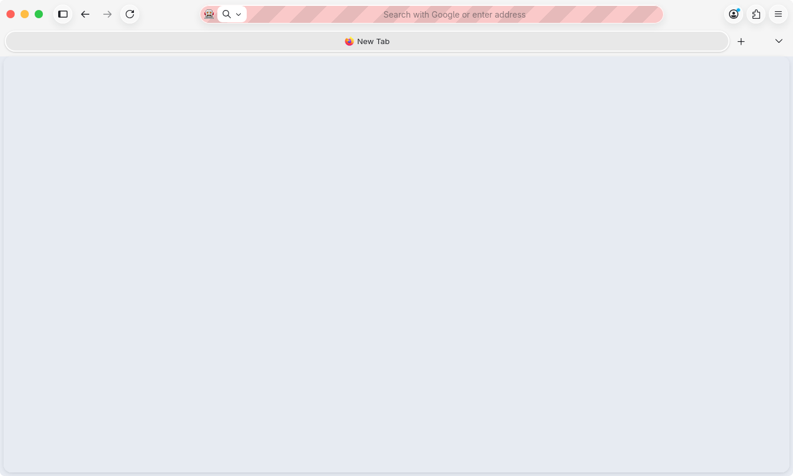
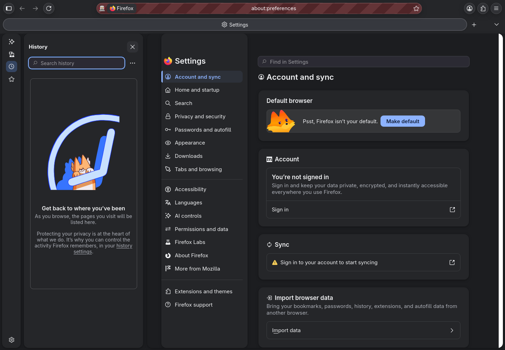
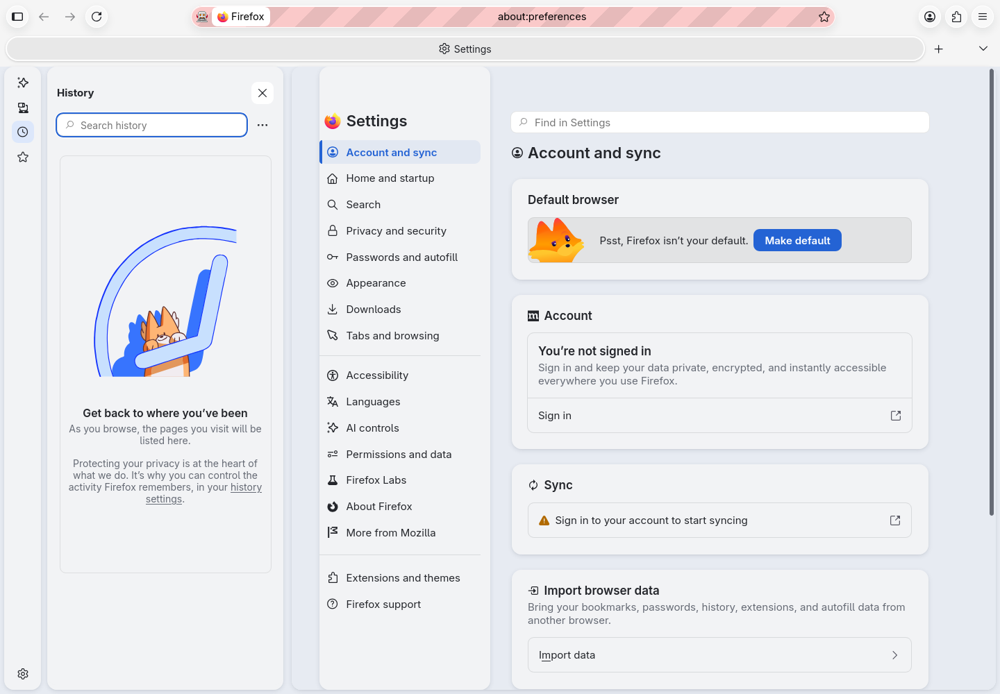

# Sequoia Eleven Floating for Firefox

A Firefox companion to the Sequoia Eleven desktop: inset floating surfaces,
14px corners, soft shadows, Adwaita Sans typography, and blue selections.
Light and dark palettes follow the system appearance. Built and checked on
Firefox **156.0.1** on Linux.

The top toolbar follows the supplied reference: individual circular buttons,
a pill-shaped address field, and a wide rounded tab strip below it. Native window
controls sit at the upper left in the desktop's exact red `#ff625a`, yellow
`#ffbd44`, and green `#30c84b`. Their symbols appear on hover or keyboard focus;
inactive windows use neutral controls. Maximize switches to the matching restore
symbol. `chrome/sequoia/header.css` controls this layout and its vector icons.

Full-width tabs use Firefox's native `--tab-max-width` token so closing animations
can finish and remove tabs from the live and saved session. The earlier direct
`max-width: none !important` override prevented that removal. After updating,
restart Firefox and close any previously stuck/restored tabs once more. Firefox
briefly holds tab widths while the pointer remains over the strip for repeated
mouse closes; remaining tabs expand when the pointer moves into the page.






## Coverage

- Navigation, address/search bars, bookmarks toolbar, horizontal and vertical tabs.
- Sidebar launcher, History, Bookmarks, synced tabs, and extension sidebar frames.
- App, context, bookmark, download, extension, identity, and permission menus/panels.
- Find bar, tooltips, status text, browser dialogs, and notification corners.
- Settings, Add-ons, New Tab/Home, Downloads, Passwords, Firefox View, and other
  selected built-in pages; Library/Places, print controls, and preferences dialogs.
- Developer tools surface colors, with syntax and diagnostic colors preserved.

Firefox's own controls and security indicators remain available. The theme does
not inject scripts or change page contents. Web pages and third-party extension
interiors own their styling; their Firefox frames receive the theme. Native file
pickers and separate OS titlebars use the desktop theme. Firefox's integrated
titlebar uses the matching traffic lights. This CSS theme uses opaque
floating surfaces; it does not request compositor blur or desktop transparency.
Firefox updates can change internal selectors, so versions other than 156 have
not been verified.

## Install and restore

Run from this directory:

```sh
python3 install.py --dry-run
python3 install.py
```

**Restart Firefox** to load both browser and built-in-page styling. The installer
selects the registered installation default when unambiguous. To choose another:

```sh
python3 install.py --list
python3 install.py --profile /path/to/firefox/profile
```

The installer backs up the existing `chrome` directory (preserving any symlink)
and `user.js` inside the selected profile, then installs the CSS and adds the
`toolkit.legacyUserProfileCustomizations.stylesheets` startup preference.
Firefox loads these profile stylesheets when that preference is enabled; see
[Mozilla's explanation](https://support.mozilla.org/en-US/questions/1550191).
It leaves the current Firefox process running. Bookmarks, extensions, browsing
data, and `prefs.js` are not edited. Updates retain the initial backup.

```sh
python3 install.py --restore
```

Restart Firefox after restoring. Later `user.js` additions are preserved, and
restoration refuses to discard edits to the installed CSS. The stylesheet-loading
preference may remain enabled in Firefox's saved preferences; restoring replaces
the CSS with your original files. Backup folders remain available in the profile.

## Customize

Edit `chrome/sequoia/palette.css` for colors, radius, spacing, shadows, and font.
Browser layout is in `browser.css`, popup surfaces in `menus.css`, and scoped
built-in-page styling in `internal.css`. Re-run the installer after editing these
source files; edit sources instead of the installed copies to keep update/restore
checks working.

## Validation

`tools/verify_tab_closing.py` tests real close-button clicks and Ctrl+W in a
disposable profile on port 2832, including removal from the DOM, reclaimed tab
width, and the flushed session state. After gracefully quitting and reopening
that profile with `browser.startup.page=3`, run it with `--restored` to check that
only retained tabs return. `preview/tab-closing-validation.json` records the
passing result, including the actual restart. This check reproduced the old bug
before the fix: a closing tab remained connected and retained its full width.

`python3 tools/check_install.py` exercises installation, updates, rollback to
the original theme, symlink preservation, and protection of later user edits.

The included `preview/validation.json` records 23 checks against an isolated
Firefox 156.0.1 profile: light/dark toolbar and sidebar colors, address-bar corners,
app and context menu surfaces, vertical-tab visibility, fullscreen CSS insets,
built-in-page canvases, ordinary page color preservation, and Firefox CSS
diagnostics. Screenshots are from actual Firefox chrome. The striped address bar
is Firefox's automation indicator, not part of the theme. Headless screenshots do
not capture separately rendered popup windows; menu colors and radii were checked
through computed styles. Print, Developer Tools, and every individual permission
dialog are styled but have not each received a visual interaction test.

`preview/header-validation.json` records 18 additional checks in a graphical
Firefox window: toolbar ordering, control placement and colors, native maximize
and restore behavior, native minimize command dispatch, and narrow-window tab
and address-field dimensions. `tools/verify_header.py` repeats these checks in
the disposable profile, launched without `--headless`. It briefly maximizes and
minimizes that test window. Firefox does not reliably report the compositor's
minimized state through this automation connection, so minimize is verified by
its native command dispatch. Narrow-window sizing is checked after explicitly
restoring the window through WebDriver.

To repeat the browser checks, create a disposable profile, install into it, add
`user_pref("marionette.port", 2829);` and
`user_pref("sidebar.revamp", true);` to its `user.js`, and launch:

```sh
firefox --headless --no-remote --profile /tmp/YOUR-TEST-PROFILE \
  --marionette --remote-allow-system-access about:preferences
```

In another terminal run `python3 tools/verify_browser.py`. Use automation only
with a disposable profile. The verifier changes test-profile appearance and tab
layout, navigates test pages, and writes preview captures.
